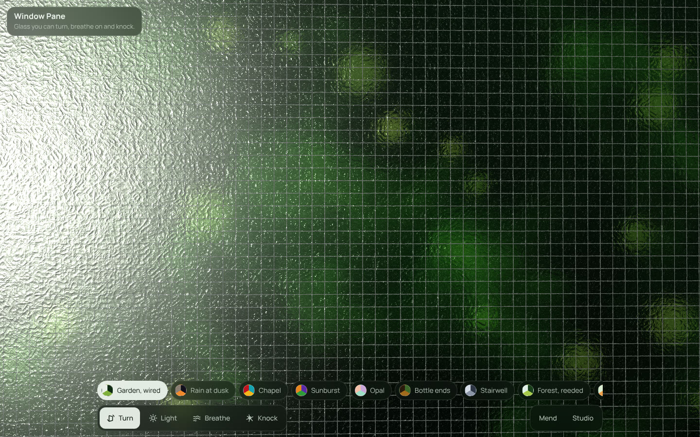
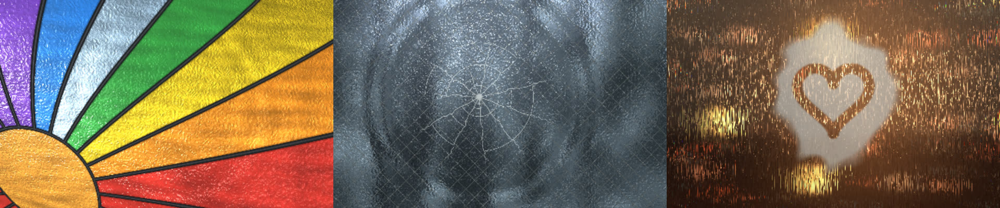
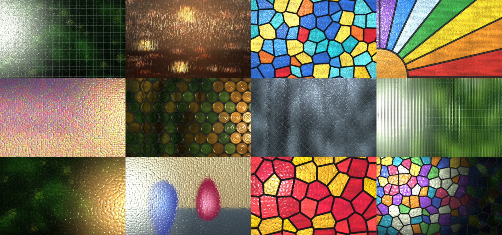

# Window Pane

A pane of patterned glass that lives in your browser. You can turn it and twist it, breathe on it and draw in the fog, steer the sun behind it, and knock on it until it cracks. It runs on plain WebGL 2 with no libraries and no build step.

**Live:** https://qc20.github.io/Window-Pane/



It started from a short clip of a three.js wired-glass demo. The question was what a window could do on a screen that a real one can't, while still behaving like glass.

## What you can do

| Tool | Mouse and keyboard | Touch | What happens |
| --- | --- | --- | --- |
| **Turn** (1) | Drag. Scroll to twist. Arrow keys nudge. | Drag | The pane rotates in perspective on a spring and settles back. Turning it away from you bends the light more, so colour fringes, glints and reflections slide across the surface. Hovering makes the pane lean slightly toward your hand. |
| **Light** (2) | Move | Drag | Steer the sun, or the lamp at night. It stays where you leave it. |
| **Breathe** (3) | Hold still, then drag. Hold space anywhere. | Hold, then drag | Condensation builds up where you breathe and slowly evaporates. Dragging wipes a clear line through it, like drawing on a cold window with a finger. |
| **Knock** (4) | Click | Tap | Each knock sends a ripple through the glass with a synthesised knock sound. Three quick knocks in one spot crack it. The wire keeps the pieces in place, and each shard bends the light a little differently. **Mend** (M) puts in a new pane. |

Under **Studio** (S) you can also:

- **Your photo:** drop any image on the page and it sits behind the glass.
- **Camera:** put yourself behind the glass, mirrored.
- **Blow on it:** blowing into your microphone fogs the glass.
- **Phone tilt:** turn the pane by tilting your phone.
- **Save image** saves a PNG. **Copy link** copies a link that opens the current preset (for example `#chapel`).

Camera and microphone input stays in your browser and is never uploaded. Some embedded viewers block these features, but the GitHub Pages link allows them.



## Presets



Each preset is based on a real kind of glass:

| Preset | Based on |
| --- | --- |
| Garden, wired | Polished wired glass with hammered texture and sun on plants. This is the original clip. |
| Rain at dusk | Rain glass with street lights behind it. |
| Chapel | Cathedral glass in a lead mosaic, lit from behind. |
| Sunburst | A leaded rainbow fan with a streaky amber sun. |
| Opal | Iridescent dimpled glass. The film colours shift as you turn it. |
| Bottle ends | Bullseye roundels in amber and green. |
| Stairwell | Smoked hammered glass with diamond wire. |
| Forest, reeded | Fluted glass with crimped wire in front of trees. |
| Flemish | Amorphous Flemish glass at golden hour. |
| Two vases | Pebbled glass with objects close behind it. |
| Red flower | Red rolled glass in a leaded flower. |
| Lobby | Satin glass with wavy wire and city lights. |
| Mosaic | Bright pieces of glass in a dense lead mesh. |

Use `,` and `.` to step through them. You can also mix your own combination in Studio:

- **Glass:** hammered, reeded, flemish, rain, pebble, roundel, satin
- **Wire and lead:** none, square wire, wavy wire, diamond wire, hex wire, lead mosaic, sunburst
- **Colour:** clear, cathedral (five palettes), opal, amber, bottle green, smoke
- **Behind the glass:** garden, forest, city at dusk, sunset, vases, white sky, your image or camera
- **Light:** noon, golden hour, overcast, dusk, night, backlit
- **Feel:** twist, relief, frost, colour split, depth behind the glass, wire and lead spacing

## How it works

Every frame runs three fragment-shader passes on a full-screen triangle.

1. **The world behind the glass** (`BG_FS`) paints the scene at half resolution into a buffer with a margin on every side, then builds mipmaps. Blur is just a higher mip level, which keeps frosting and fog cheap.
2. **Breath** (`FOG_FS`) keeps a condensation layer in a pair of textures that take turns. Each frame adds breath where you hold still, wipes a capsule-shaped line where you drag, and lets the layer evaporate slowly.
3. **The pane** (`GLASS_FS`) does most of the work:
   - It casts a ray from the camera to a rotated plane. The twist turns each row of the pane a little more than the one below it.
   - It reads a height field for the chosen glass type in the pane's own flat coordinates. The heights come from noise, Voronoi cells or hex lattices, measured in CSS pixels, so the texture stays the same physical size on any screen.
   - It refracts the view ray in and out of an 8 px thick slab with Snell's law, once each for red, green and blue. The colour split grows as the pane turns away from you.
   - It adds glints from the sun, a Fresnel reflection of a room behind you (a window and a lamp), thin-film colour for opal glass, wire inside the glass and lead on top of it, cracks, ripples and fog.

The springs, pointer handling, sound and interface are plain JavaScript modules. If a device can't keep up, the page lowers its resolution.

| File | What it holds |
| --- | --- |
| `index.html` | Markup and controls |
| `css/style.css` | Layout and the smoked-glass panels |
| `js/main.js` | WebGL setup, springs, tools, input, the frame loop |
| `js/shaders.js` | The three shaders and their shared noise functions |
| `js/presets.js` | Glass types, lights, palettes and presets |
| `js/sound.js` | Synthesised knock and crack sounds, and the microphone level |

## Run it locally

The modules need to be served over HTTP:

```sh
git clone https://github.com/QC20/Window-Pane.git
cd Window-Pane
python3 -m http.server 8000
# open http://localhost:8000
```

It works in any browser with WebGL 2, which means recent versions of Chrome, Edge, Firefox and Safari, on desktop and mobile.

## Design ideas it tries out

- **Behaves like the material.** It refracts, it bends colour more at steep angles, the wire holds a cracked pane together, and breath evaporates.
- **Uses your body as input.** You can breathe on it, blow into the microphone, tilt your phone, or rest your hand near the pane.
- **Damage and repair.** Knocking leaves marks that stay until you choose to mend the glass.
- **More than one sense.** Knocks and cracks have sound, and they come from synthesis, not recordings.
- **Your own world behind the glass.** Your photo or your camera feed can sit behind the pane.

## License

Apache 2.0, see [LICENSE](LICENSE).
